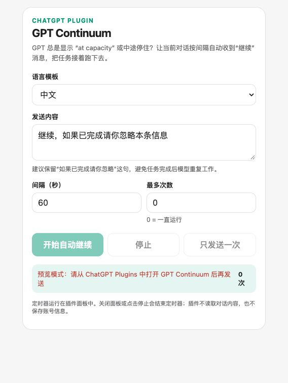

# GPT Continuum

<p align="center"></p>

<p align="center"><strong>GPT を「at capacity」で止めない。</strong></p>

GPT が「at capacity」と表示され、長いタスクが途中で止まり、公式クライアントも自動再試行してくれない？GPT Continuum には 2 つのモードがあります。プラグインは現在の会話を扱い、ブラウザー拡張は複数の ChatGPT 会話タブを同時に制御します。

## 解決する問題

混雑時や長いコード生成では、ChatGPT が **at capacity**、一時停止、早期終了になることがあります。GPT Continuum は手動の「続けて」を、いつでも停止できる見えるタイマーに変えます。



## 機能

- HTTPS サービス、データベース、OpenAI API キーが不要
- ChatGPT 公式の `sendFollowUpMessage` を使用
- 中国語・英語テンプレートとカスタムメッセージ
- 送信間隔と最大送信回数を設定可能
- 開始、停止、1 回だけ送信、全画面表示に対応
- 会話内容を読み取らず、キーボードやクリップボードも操作しない
- インストール後に自動起動するローカル `stdio` MCP サーバー

## インストール

### 複数会話モード（推奨）

複数の会話を同時に監視して送信する場合は、[ブラウザー拡張](extension/README.md)を使ってください。Windows と macOS の Chrome/Edge で動作し、選択した ChatGPT タブの **Steer** を優先してクリックし、Steer がない場合は送信ボタンを使います。

### 1 会話用プラグインモード

ユーザーは Node.js 20 以上をインストールして、次を実行します。

```bash
npx --yes github:JulianRyder01/GPT-Continuum install
```

ChatGPT デスクトップアプリを再起動し、**Plugins → Personal** から **GPT Continuum** を検索してインストールします。新しい会話でプラグインを開き、メッセージと間隔を設定して **Start** を押してください。

プラグインモードは ChatGPT 公式ブリッジの制約により、プラグインを開いた現在の会話にだけ送信できます。別の既存会話は選択できません。

## 開発

```bash
npm install
npm test
npm start
```

`npm start` はローカル MCP stdio サーバーを起動します。標準出力は MCP プロトコル用に予約され、診断情報は標準エラーに出力されます。

## 安全性と制限

このプラグインは時間に基づいてメッセージを送信します。回答を読み取ったり、タスク完了を判断したりはしません。デフォルトメッセージには、タスクが完了している場合は無視するように指示が含まれています。完了したら **Stop** を押してください。

最初は 30–60 秒の間隔をおすすめします。短すぎる間隔は重複リクエストや ChatGPT のレート制限につながる可能性があります。プラグインパネルを閉じるか、ローカルプラグインに対応していない ChatGPT クライアントを使うとプラグインのタイマーは停止します。ブラウザー拡張では選択した ChatGPT タブを開いたままログインしておく必要があります。

このプロジェクトはローカル `stdio` を使用するため、ユーザーが HTTPS をデプロイする必要はありません。公開 Plugin Directory でローカル MCP を配布する場合は Desktop only と追加審査の要件があります。

### “No plugins found” と表示される場合

**ChatGPT デスクトップアプリ**を完全に終了して再起動し、もう一度 **Plugins → Personal** を開いてください。`http://127.0.0.1:8765/gpt-continuum.html` のローカルプレビューでは送信をテストしないでください。このページには ChatGPT のメッセージブリッジがなく、画面確認専用です。Personal が空のままなら、上の `npx` コマンドを再実行してください。インストーラーが `~/.agents/plugins/marketplace.json` を更新します。

## ディレクトリ構成

```text
GPT-Continuum/
├── assets/logo.png
├── extension/
├── public/gpt-continuum.html
├── server.mjs
├── install.mjs
├── mcp.json
└── plugin.json
```

## ライセンス

MIT。詳しくは [LICENSE](LICENSE) を参照してください。
