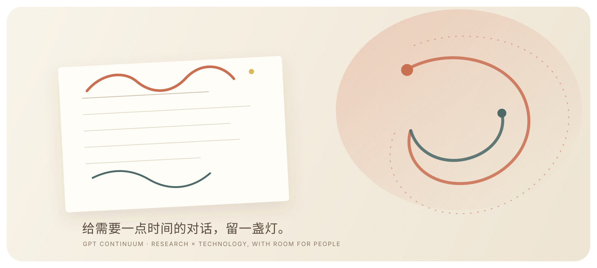

<div align="center">
  

  <p><strong>让长任务继续向前，也让等待变得有迹可循。</strong><br />
  一个本地运行的 ChatGPT Plugin / MCP App，按你设定的节奏发送下一句。</p>

  <p>
    <a href="README.zh-CN.md">中文说明</a> ·
    <a href="README.en.md">English</a> ·
    <a href="README.ja.md">日本語</a> ·
    <a href="https://www.xiaohongshu.com/user/profile/65546f5f0000000002028ac0">小红书 @Aplus云组会</a>
  </p>
</div>

> 有些工作不是难在开始，而是难在被打断以后，重新回到它身边。GPT Continuum 只做一件小事：在你愿意的时候，替你把“继续”送回当前对话。

## 它适合什么时刻

- 长任务因为容量限制、短暂中断或模型停顿而停在半路
- 你希望保持节奏，但不想读取聊天内容或接管键盘
- 你需要一个轻量、透明、关掉就会停止的本地工具

## 开始使用

安装 Node.js 20+ 后，在终端运行：

```bash
npx --yes github:JulianRyder01/GPT-Continuum install
```

重启 ChatGPT 桌面端，在 **Plugins → Personal** 搜索并安装 **GPT Continuum**。打开插件，写下你想发送的内容，选择间隔，然后点击 **开始自动继续**。

插件使用本地 `stdio` MCP 服务，不要求部署 HTTPS、数据库或 OpenAI API Key。它只按时间发送消息，不读取对话内容，也不保存账号信息；任务完成后点击 **停止** 即可。

## 小而明确的能力

| 你可以调整 | 它会做什么 |
| --- | --- |
| 发送内容 | 使用中文、英文模板，或写下自己的话 |
| 发送间隔 | 从 5 秒到 24 小时，按你的工作节奏来 |
| 最多次数 | 设为 `0` 表示持续运行，随时可以停止 |
| 发送方式 | 立即发送一次，或进入 PiP 小窗持续运行 |

建议从 30–60 秒开始。间隔过短可能触发 ChatGPT 限流；关闭插件面板或使用不支持本地插件的客户端后，计时器会停止。

## 本地开发

```bash
npm install
npm test
npm start
```

`npm start` 启动 MCP stdio 进程。标准输出保留给 MCP 协议，诊断信息写入标准错误。

```text
GPT-Continuum/
├── assets/hero.svg           # README 首页插图
├── assets/logo.png           # 插件图标
├── public/gpt-continuum.html # ChatGPT 面板
├── server.mjs                # 本地 MCP 服务
├── install.mjs               # 一键安装脚本
├── mcp.json                  # 本地 stdio 配置
└── plugin.json               # 插件清单
```

## 关于这个小项目

GPT Continuum 是一个很小的工具，也是一种工作习惯：把主动权留在人的手里，让工具只在被需要的时候轻轻推门。它想站在科研与科技之间，帮那些需要一点时间的思考保持连续。

如果你也在做需要时间的事，欢迎在 [Issues](../../issues) 里留下想法，或在小红书找到 **[@Aplus云组会](https://www.xiaohongshu.com/user/profile/65546f5f0000000002028ac0)** 聊聊。

## 许可证

MIT，见 [LICENSE](LICENSE)。
